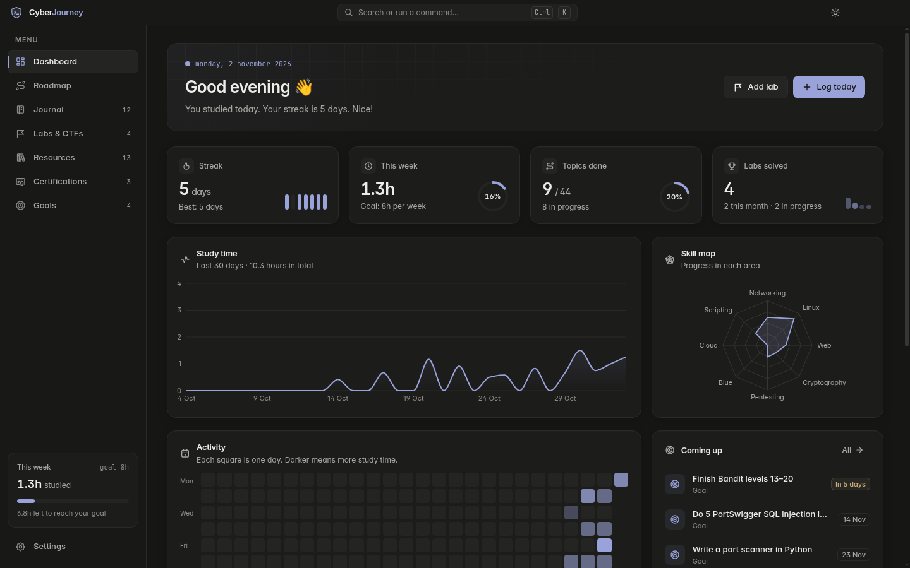

# kryfsec desktop

kryfsec is a desktop app to plan, track and write down your cyber security learning.
Everything stays on your computer.
Website: [kryfsec.com](https://kryfsec.com)

There is also a phone app: [kryfsec-mobile](https://github.com/0xbasinas/kryfsec-mobile).



## What you can do

- **Dashboard** – study streak, hours this week, 30-day chart, skill radar, activity map, next goals and exams.
- **Roadmap** – 8 skill areas (Networking, Linux, Web, Crypto, Pentesting, Blue team, Cloud, Scripting) with topics. Click a topic to mark it *To do → Learning → Done*. Add your own areas and topics.
- **Journal** – daily notes in Markdown with live preview, tags, study time and a linked topic.
- **Labs & CTFs** – board or list of boxes and challenges (TryHackMe, HTB, PortSwigger, picoCTF…), with flags and a write-up for each.
- **Resources** – courses, books, videos, tools and links, with status and rating.
- **Certifications** – Security+, eJPT, OSCP or any other: steps, progress and exam date timeline.
- **Goals** – goals with deadlines and checklists.
- **Search everywhere** – press `Ctrl+K` for the command palette. `Ctrl+J` starts a new journal entry.
- **Your data** – export / import JSON backups, export everything as Markdown, remove the sample data in one click.
- Dark and light theme, a calm, mostly gray palette with one soft accent (Periwinkle, Sage or Rose). Inspired by Linear and Vercel Geist. All text passes WCAG AA contrast.

## Install

- **Windows:** run `kryfsec-Setup-<version>-x64.exe`. The installer is not signed, so Windows SmartScreen may say "Windows protected your PC" → click **More info → Run anyway**. A portable `.zip` is also built.
- **Linux:** `chmod +x CyberJourney-<version>-x86_64.AppImage` and run it.

Your data is one file: `kryfsec.json` in the app data folder
(Windows: `%APPDATA%\kryfsec`). Settings → *Your data* shows the exact path. A `.bak` copy is kept next to it.
If you used the app under its old name, your data is copied over the first time kryfsec starts (the old file is kept).

## Develop

Needs Node.js 22+.

```bash
npm install
npm run dev          # start with hot reload
npm run typecheck
npm run lint
npm run build        # typecheck + production build into out/
npm run package:win  # Windows NSIS installer + zip into release/
npm run package:linux
npm run screenshots  # needs an X display, default :5 (e.g. Xvfb)
```

`package:win` works on Linux without Wine: `scripts/nsis-no-wine` lets electron-builder
pull the uninstaller out of the installer with its own built-in reader.

## Stack

Electron 38, electron-vite, React 19, TypeScript, Tailwind CSS 4, zustand,
recharts, react-markdown + remark-gfm, cmdk, Radix UI, Tabler icons, date-fns, sonner.

## Licenses

MIT – see [LICENSE](LICENSE). Third-party packages: [THIRD_PARTY_NOTICES.md](THIRD_PARTY_NOTICES.md).
